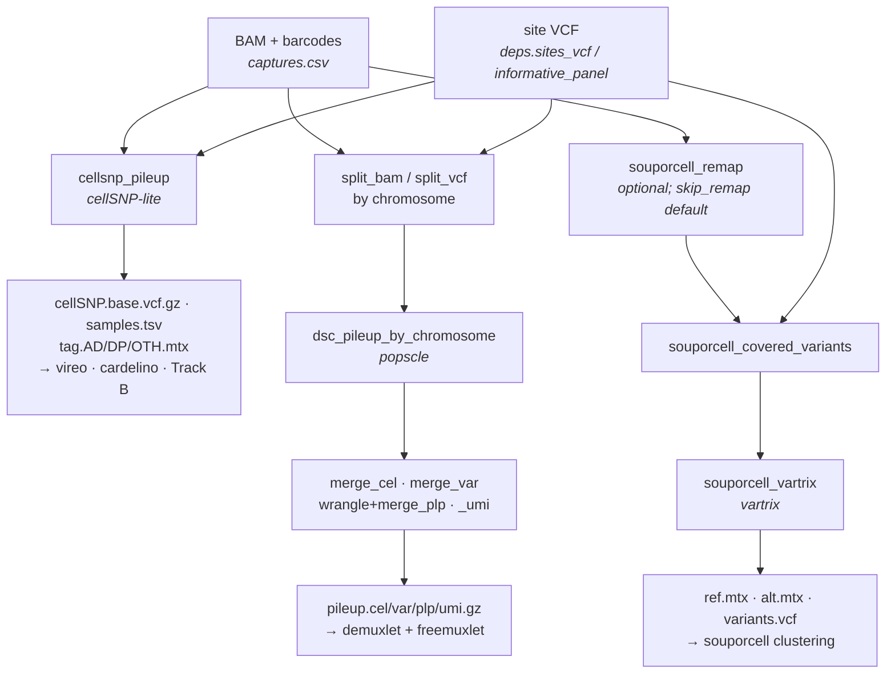

# sc_pileup

A small, reusable Snakemake workflow that turns single-cell BAMs into **per-cell
REF/ALT count matrices** at a configurable set of sites. It factors the
expensive, deterministic *pileup* out of the *assignment* step so that:

- **genotype demux** (vireo / demuxlet / freemuxlet / souporcell in `snp_demux`)
  can be re-run and re-tuned cheaply, resuming from saved pileups instead of
  re-reading BAMs;
- the same matrices feed **malignant-cell / clonal** analyses — somatic-variant
  detection (Track A), allelic imbalance in CNV/LOH regions (Track B), and
  `cardelino` — when pointed at a somatic / CNV-region site VCF.

Design rationale and the wider plan (WGS+microarray panel, demux improvements,
cardelino) live in [`docs/design_pileup_stage.md`](docs/design_pileup_stage.md).

## The abstraction

```
pileup(bam, barcodes, platform, sites_vcf) -> per-cell REF/ALT counts at sites
```

The pileup is **genotype-free**: it tallies every barcode at every site,
irrespective of donor. Donor subsetting / assignment happens downstream. So the
only sample sheet is `config/captures.csv` (one row per capture); no per-donor
genotype wrangling lives here.

## Engines

| engine | tool | output | consumers | platforms |
|---|---|---|---|---|
| `cellsnp` | cellSNP-lite | MEX: `cellSNP.base.vcf.gz`, `cellSNP.samples.tsv`, `cellSNP.tag.{AD,DP,OTH}.mtx` | vireo, Track B, cardelino | short, long* |
| `popscle` | popscle `dsc-pileup` | `pileup.{cel,var,plp,umi}.gz` | demuxlet **and** freemuxlet (shared) | short |
| `souporcell` | minimap2 + vartrix | `ref.mtx`, `alt.mtx`, `variants.vcf` | souporcell clustering | short |

Outputs are written under `results/<engine>/<platform>/<capture_id>/` so
short- and long-read pileups of the same capture coexist and can be merged
per cell downstream.

\* **Long-read (PacBio) note.** Full-length HiFi reads cover the whole transcript
body, not just the 3′ end, so many more exonic somatic sites become observable —
this is the main reason the malignant-detection direction is worth pursuing. The
`platform` dimension is wired through the config and output layout, but the
long-read pileup parameters (splice-aware handling, UMI semantics, SNV-preferring
site QC) are **placeholders to be tuned against real PacBio single-cell BAMs**
(`params.cellsnp_lite.platform_args.long`). `popscle` and `souporcell` are
short-read only for now.

## Tools

Each engine wraps a well-established single-cell genotyping tool, all run inside
the shared `Demuxafy.sif` image:

1. **cellSNP-lite** — the `cellsnp` engine; per-cell REF/ALT/OTH pileup at the
   site VCF. [docs](https://cellsnp-lite.readthedocs.io/) | [paper](https://doi.org/10.1093/bioinformatics/btab358) | [GitHub](https://github.com/single-cell-genetics/cellSNP-lite)
2. **popscle** (`dsc-pileup`) — one shared pileup that feeds **both** demuxlet and
   freemuxlet downstream. [demuxlet paper](https://www.nature.com/articles/nbt.4042) | [GitHub](https://github.com/statgen/popscle)
3. **souporcell** — genotype-free clustering prep: [minimap2](https://github.com/lh3/minimap2)
   remap (optional) then [vartrix](https://github.com/10XGenomics/vartrix) counts
   → `ref.mtx` / `alt.mtx`. [paper](https://www.nature.com/articles/s41592-020-0820-1) | [GitHub](https://github.com/wheaton5/souporcell)

Downstream these matrices are consumed by vireo / demuxlet / freemuxlet /
souporcell in [`snp_demux`](https://github.com/swarbricklab/snp_demux).

## Workflow

All three engines start from the same inputs — a BAM + barcode list (per
`captures.csv`) and a **site VCF** (either `deps.sites_vcf`, or a per-pool
`informative.vcf.gz` built on the fly by the optional `informative_panel` rule).



With `skip_remap` (the default) the `souporcell_remap` minimap2 step is skipped
and vartrix counts directly on the original cellranger BAM — validated to be a
no-op for the covered-site matrices.

## Contributions

The pileup rules were factored out of, and are heavily indebted to,
[`swarbricklab/snp_demux`](https://github.com/swarbricklab/snp_demux)
(`rules/vireo.smk` cellSNP, `rules/demuxlet.smk`/`freemuxlet.smk` dsc-pileup,
`rules/split.smk`, and `scripts/{merge_cel,merge_var,wrangle_plp,wrangle_umi}.py`),
then reviewed and generalised. The souporcell prep rules are lifted from
[`souporcell_pipeline.py`](https://github.com/wheaton5/souporcell) (renamer →
minimap2 → retag → covered-variant depth filter → vartrix).

`snp_demux` is itself a simplification and refactoring of the
[demuxafy](https://github.com/swarbricklab/demuxafy) workflow developed by
[Daniel Roden](https://github.com/dlroden) and
[Beata Kiedik](https://github.com/BeataKiedik), which in turn wraps the
[Demuxafy](https://demultiplexing-doublet-detecting-docs.readthedocs.io/en/latest/index.html)
package and tools developed by [Drew Neavin](https://github.com/drneavin) at the
Powell Lab.

Key changes vs the `snp_demux` originals: outputs are no longer `temp()`; the
site VCF is generic; the redundant demuxlet/freemuxlet pileups are merged into
one; genotype-free (no `--sm-list`); platform-aware paths. See the header
comments in each rule file.

## Quickstart

1. Edit `config/config.yaml`: point `deps.sites_vcf` at a bgzipped+indexed VCF
   (GRCh38, matching the BAMs), choose `engines`, and set the cellsnp `minMAF`/
   `minCOUNT` for your purpose (germline panel: `0.01`/`10`; targeted somatic:
   `0`/`1`).
2. Fill `config/captures.csv`: `capture_id,platform,bam,barcodes`.
3. Provide the container at `resources/Demuxafy.sif` (same image `snp_demux`
   uses).
4. Dry run, then run:
   ```bash
   ./run.sh -n          # dry run
   ./run.sh -c 32       # local
   ```

## Testing

A small, self-contained reproducibility test exercises **all three engines** on a
public fixture:

- `test/data/` (DVC-tracked) — a tiny_pbmc cellranger BAM (from
  [`chromium-preprocessing`](https://github.com/swarbricklab/chromium-preprocessing)'s
  public test data) subset to two windows, plus a site VCF subset from the
  souporcell IGSR/1000G GRCh38 common-SNP panel. Regenerate with
  [`test/make_test_fixtures.sh`](test/make_test_fixtures.sh), which documents the
  provenance. The pileup is genotype-free, so the VCF is just positions.
- `test/golden/` (DVC-tracked) — the expected pileup outputs.
- Run it:
  ```bash
  dvc pull                # fetch test/data + test/golden
  ./run_test.sh --check   # run all three engines, content-compare to the golden
  ```
  [`test/compare_golden.py`](test/compare_golden.py) compares *content*
  (decompressing `.gz`, ignoring VCF headers) so gzip mtimes don't cause false
  diffs. CI (`.github/workflows/pr-validation.yml`) runs exactly this on the NCI
  qxub-runner for every PR.
